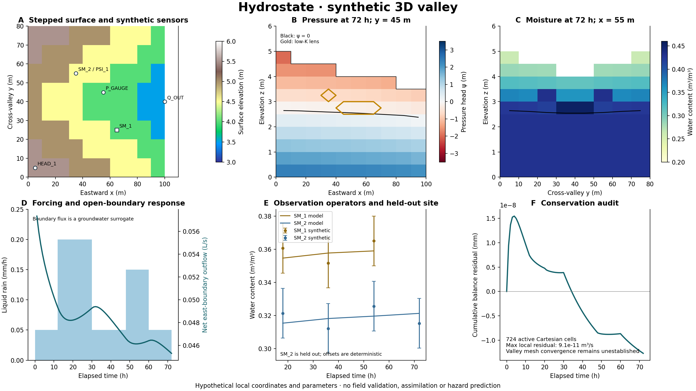

# Hydrostate

[](https://github.com/gaia-hazlab/hydrostate/actions/workflows/ci.yml)

**Watershed vadose-zone and groundwater research for climate-compounded geohazards.**

Hydrostate develops conservative hydrologic prototypes, numerical verification
experiments and sensor interfaces toward coupling DHSVM land-surface processes
with variably saturated flow and deeper MODFLOW groundwater. It is a
[GAIA Hazlab](https://github.com/gaia-hazlab) research project.

**Status: research alpha.** The implemented solvers are independent reference
experiments. A production DHSVM–MODFLOW coupler and calibrated hazard forecasting
are future work. Mathematical verification, numerical convergence and field
validation are tracked separately. The existing 2D hillslope outlet hydrograph
is explicitly **not mesh-converged**.

## What is here

| Component | Implemented scope | Current limit |
| --- | --- | --- |
| 3D valley | Cartesian finite-volume subsurface flow with a stepped valley surface, heterogeneous soil and a fully 3D face graph | Synthetic geometry/parameters; restricted forcing/boundary regime; no flood hydraulics |
| 2D hillslope | Mixed Richards flow, layered lens, canopy/snow stores, root stress, ponding and lumped channel | Strong vertical-grid sensitivity of runoff; no complete dry-channel treatment |
| Mathematical verification | Known solutions, physical invariants and manufactured-solution refinement experiments using the numerical kernel | Each result verifies its stated regime, not every nonlinear process or field application |
| Sensor workflow | CSV ingestion, metadata/QC, observation operators and held-out comparison metrics | Synthetic fixtures demonstrate interfaces; real observations are not bundled and online assimilation is not implemented |
| Material coupling | Exact-grid material transactions preserve each cell's stored water while reconciling pressure under new retention/storage laws; detached hydraulic restarts | Prescribed fixed-volume changes; no deformation, earthquake pore-pressure generation or moving landslide geometry |
| Gaia DataHub interchange | Typed xarray/DataTree, dynamic materials, exact event times, interval ledgers and complete coupled restart payloads through pinned Gaia Zarr/STAC APIs | Model-aware readers are required; Gaia horizontal alignment/averaging is not a 3D coupling or restart operation |
| MODFLOW foundation | Existing FloPy/MF6 smoke template and regional data-source workflow | Template is not a calibrated Puget Sound groundwater model |
| Coupling/parallel design | Process ownership, Richards–deep aquifer interface, ecological/geotechnical exports and spatial decomposition | Target architecture, not an implemented distributed coupler |

## Quick start

Python 3.11 or later:

```bash
git clone https://github.com/gaia-hazlab/hydrostate.git
cd hydrostate
python -m venv .venv
source .venv/bin/activate
python -m pip install -e ".[toy,dev]"
python -m unittest discover -s tests -v
```

Run mathematical verification and the synthetic 3D valley:

```bash
hydrostate verify --output runs/verification/report.json
hydrostate valley --output runs/valley3d/results.json
hydrostate sensors --model runs/valley3d/results.json \
  --sensors examples/sensors/sensors.csv \
  --observations examples/sensors/observations.csv \
  --output runs/sensors/report.json
python scripts/plot_valley.py --output runs/valley3d/valley3d.png
```



This 100 × 80 m synthetic valley has 724 active cells, a finite low-conductivity
lens and flow in all three directions. The example compares moisture, pressure,
screened head, boundary discharge and precipitation through explicit observation
operators. Sensor values are generated from the same run with deterministic
offsets; they demonstrate the workflow and are not field observations.

The existing macOS ARM Pixi environment also supports:

```bash
pixi install
pixi run test
pixi run verify-math
pixi run valley3d
```

The Pixi lock targets macOS ARM; the pip workflow and CI provide the portable
numerical path. MODFLOW executables and geospatial dependencies are optional
for the independent Richards/verification examples.

For Gaia DataHub interoperability, use **Python 3.12 or later** and install the
separate optional stack:

```bash
python -m pip install -e ".[toy,dev,datahub]"
HYDROSTATE_REQUIRE_GAIA=1 python -m unittest discover -s tests -v
```

The `datahub` extra pins Gaia to the audited source commit and includes its
geospatial/provider dependencies. The pinned Gaia dependency `rioxarray>=0.23`
requires Python 3.12+, while the independent numerical core supports Python
3.11+. The extra is not added to the default numerical
Pixi environment. CI requires an actual Gaia write/read in its interoperability
job; a missing optional dependency cannot silently skip that job's checks.

## Experiments, observations and mathematical evidence

- [3D valley experiment and use cases](docs/use_cases.md): geometry, forcing,
  sensor locations and progression from simple problems to watershed questions.
- [Technical reports](docs/technical/): governing equations, finite-volume
  residuals, constitutive laws, verification derivations, measured errors and
  remaining gaps.
- [Sensor ingestion and validation](docs/sensors.md): units, CRS/datum, depths,
  well screens, uncertainty, UTC valid/arrival times, QA and comparison metrics.
- [Conservative material updates and hydraulic restarts](docs/technical/material_updates.md):
  the storage inverse, fixed-volume transactions, failure branches and restart
  identity checks.
- [Gaia DataHub contract](docs/datahub_contract.md): typed static/dynamic arrays,
  references, provenance, interval bounds, event discontinuities and complete
  recovery-memory checkpoints.
- [2D toy report](docs/toy_watershed.md): reproducible numerical checks and the
  unresolved wetting-front/ponding sensitivity.

The main balance uses total hydraulic head `H = z + psi`,
`q = -K(psi) grad(H)` and an explicit water-storage law. Internal face transfers
cancel pairwise. Nonlinear residual, pressure increment and water budget are
all checked. A small budget residual alone does not establish a correct
hydrograph, convergence order or field accuracy.

Sensor observations are compared through operators that respect their support:
soil moisture at a stated volume/depth, pressure with an air/datum reference,
well head over a screen and discharge over its reporting interval. Precipitation
is treated as forcing evidence. Confined head is not automatically the shallow
water table. Synthetic noisy observations test this pipeline without claiming
independent physical validation.

## Research direction

[The vadose design](docs/vadose_design.md) defines multidimensional Richards
flow for root-zone, vadose, perched and shallow saturated storage, with a
nonoverlapping deep MODFLOW domain. Ecology includes water-stress response,
compensation and hydraulic redistribution as staged capabilities. Geotechnical
modules consume pressure/suction/saturation and add their own strength,
shaking/deformation or stability physics.

[Mechanicalstate](https://github.com/gaia-hazlab/mechanicalstate) is the
companion for geological/seismic structure, uncertain material priors and
hydromechanical seismic observation operators. Its exact-grid adapter supplies
retention/permeability materials to this solver; Hydrostate retains ownership
of pressure, moisture and water storage. The material transaction now supports
prescribed time-varying retention, conductivity and storage on the same grid:
it conserves `W` per cell and recovers pressure through the updated constitutive
law. The companion supplies prescribed disturbance/recovery scenarios and their
restart memory. Seismic images do not uniquely specify hydraulic properties,
and diagnostic capillary pressures do not modify the Richards equation.
This interface does not predict damage initiation, liquefaction, slide motion
or biological recovery; these require additional process models and evidence.

[Spatial parallelization](docs/spatial_parallelism.md) starts with horizontal
tiles retaining vertical profiles, conservative face ownership and global
implicit solves. Independent columns are an assessed physical approximation;
column-block preconditioning can accelerate the full lateral-flow equations.
Persistent APIs, matrix/work-buffer reuse and measured solver/I/O optimization
precede speculative acceleration.

The broader [feasibility assessment](docs/coupling_feasibility.md) covers a
workstation watershed pilot, Rainier-scale domains and a regional western
Washington backbone. The original monthly Puget Sound workflow remains in the
[legacy pipeline guide](docs/puget_pipeline.md).

## Repository layout

```text
src/hydrostate/          3D numerical core, verification, observations, material coupling and DataHub
src/puget_modflow/       Legacy pipeline, MF6 template and 2D reference
examples/sensors/       Small synthetic sensor metadata and observations
docs/technical/         Equations, verification reports and measured evidence
docs/                   Designs, use cases, sensor guide and legacy reports
scripts/                Plotting, sensitivity and demonstration helpers
tests/                  Unit, mathematical and physical-invariant checks
.github/workflows/      Public CI tests and verification artifacts
```

Raw data and generated `runs/` outputs are ignored. Keep complete run metadata
and software versions when conducting research; commit small synthetic inputs
and compact evidence rather than private observations or large output fields.

## Contributing and citation

Read [CONTRIBUTING.md](CONTRIBUTING.md) and [AGENTS.md](AGENTS.md). A numerical
change needs independent expected behavior, appropriate convergence/budget
checks and updated limitations. Performance changes retain the equations and
accuracy targets of the reference experiment.

Code is released under the [MIT license](LICENSE). Use [CITATION.cff](CITATION.cff)
and cite the physical/numerical methods relevant to the experiment. Current
software is research infrastructure, with no validated operational warning
capability.
